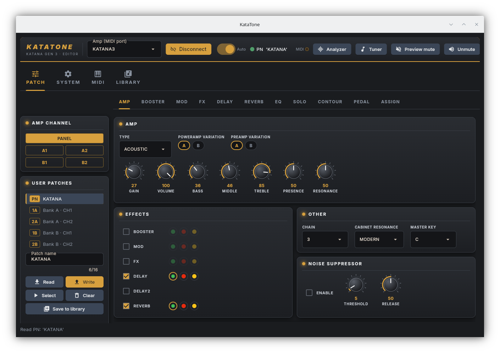

# KataTone

A Linux patch editor for the **BOSS Katana 50 Gen 3** amplifier.

Edit every parameter of a patch, keep a local library of patches, download
patches from BOSS Tone Central, and control the amp from MIDI footswitches,
pedals and keyboards.  It talks to the amp over USB-MIDI, and runs as a desktop
window or as a browser interface, for example on a Raspberry Pi next to the amp.



> **Unofficial.**  Not affiliated with or endorsed by Roland or BOSS.  BOSS,
> Katana, BOSS TONE EXCHANGE and BOSS TONE CENTRAL are trademarks of Roland.
> Writing to an amp is at your own risk: save your patches to the library
> before overwriting amp slots.

## Features

- **Patch editor** — all parameters of a patch, with live edits sent to the amp
- **Library** — save patches into livesets (`.tsl` files) and write them back to the amp
- **Tone Central** — browse and download patches from the official BOSS site
  ([details](docs/tone-central.md))
- **Analyzer** — level meter and spectrum of the amp's USB audio, with a
  reference recording and A/B takes to compare tones, with EQ settings that fit,
  note and spectrogram analysis, and tap tempo
  ([details](docs/analyzer.md))
- **Tuner** — a guitar tuner for the amp's audio input ([details](docs/tuner.md))
- **System settings** — edit the amp's global settings
- **MIDI controllers** — switch channels, toggle effects and drive wah / volume
  from pedals and keyboards ([details](docs/midi-controllers.md))
- **Browser interface** — the same app in a browser, with a login
  ([details](docs/web.md))
- **Raspberry Pi** — headless use, Wi-Fi with an access-point fallback, read-only
  file system ([details](docs/raspberry-pi.md))
- **SD-card image** — a ready-made system for the Raspberry Pi 3 and 5 that boots
  straight into the browser interface, built with Docker ([below](#sd-card-image-for-the-raspberry-pi))

## Install

Needs Linux and Python 3.10+:

```bash
pipx install --system-site-packages "katatone[desktop] @ git+https://github.com/jpbarraca/katatone"
```

Extras, system packages and troubleshooting: [Install](docs/install.md).

## Use

Connect the amp with a USB cable and run `katatone-gui` for the window or `katatone-web` for
the browser.  It connects to the amp by itself.  Edit a tone in the **PATCH** tab,
then **Save to library** to keep it, or **Write** to store it in an amp slot.

`katatone-gui --help` and `katatone-web --help` list the options.  There is also a command line: `katatone ports`, `katatone read --in KATANA3 --out
KATANA3 --patch 0`, ... — see `katatone --help`.

## SD-card image for the Raspberry Pi

`docker/rpi` builds a complete SD-card image for the **Raspberry Pi 3** and
**Raspberry Pi 5**: a small mainline Linux (7.3) that boots from RAM and runs
`katatone-web` as its main program, with nothing to install on the Pi.  The
image is not a Raspberry Pi OS: there is no desktop, no package manager and
no login shell by default.

```bash
docker build -f docker/rpi/Dockerfile --output type=local,dest=out .
sudo dd if=out/rpi5-prod.img of=/dev/sdX bs=4M conv=fsync    # or rpi3-prod.img
```

Nothing is compiled by the build: `docker/rpi/bin.tar.xz` holds the prebuilt
kernels, busybox, hostapd and the arm64 Python runtime (listed in
`docker/rpi/bin.txt`), and the build only adds this checkout of KataTone with its
Python dependencies from PyPI.  `--build-arg KATATONE_SOURCE=github` takes the
latest commit on GitHub instead, `--build-arg BOARDS=pi5` builds one board, and
`--build-arg VARIANT=dev` makes the development images, which print the kernel
log on the UART and keep boot logs in `/home`.

On the Pi:

- **Wi-Fi.**  The Pi is an access point: join the network `KataTone` (key
  `KataTone`) and open `http://192.168.4.1:8550/`.  The login password is
  `KataTone` until you change it.  `/home/hostapd.conf` on the card's second
  partition overrides the access point settings.
- **Amp and audio.**  USB-MIDI, the Analyzer and the Tuner work as on any Linux;
  the amp over Bluetooth needs a one-time pairing from a shell (`bluetoothctl`).
- **Storage.**  The system runs from RAM; only `/home` is on the card (btrfs,
  grown to the card's size at the first boot) and holds the patch library, the
  password and the Bluetooth pairings.  Pulling the power is safe.
- **Power button and serial.**  The Pi 5 power button shuts the system down.
  KataTone's output is on the GPIO UART (pins 8 and 10, 115200 baud); a file
  named `shell` in `/home` gives a root shell there at the next boot.

## Terms of service

KataTone makes no requests of its own to the BOSS TONE EXCHANGE and is built to
stay within its [terms of service](https://bosstoneexchange.com/terms_and_conditions/);
the details are in [Tone Central](docs/tone-central.md#terms-of-service).

## More

- [Development](docs/development.md) — project layout, running the tests
- Developed and tested with a Katana 50 Gen 3 only.
- License: Apache 2.0 — see [`LICENSE`](LICENSE).
